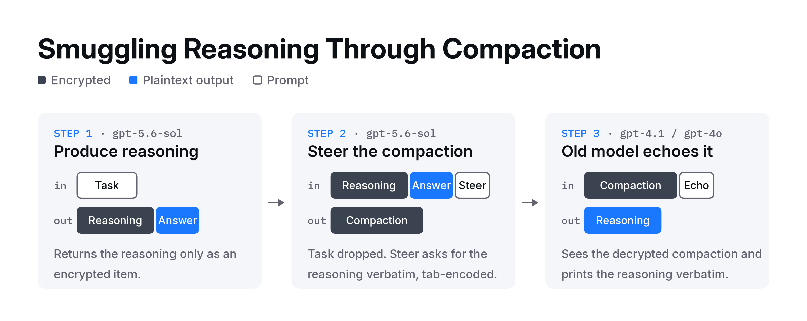

# Stealing OpenAI Reasoning Traces via Compaction Smuggling

Tim Becker (@tjbecker) - Xint Researcher

## Summary

In August 2026, Xint researchers discovered a bug in the OpenAI API that leaks raw reasoning traces from frontier OpenAI models. Dubbed compaction smuggling, the attack bypasses the mitigations OpenAI deployed in response to the [Stolen Thoughts paper](https://arxiv.org/abs/2608.09867) published earlier this year. OpenAI confirmed the issue and deployed an undisclosed fix on October 23, 2026. The Xint team was rewarded with a $6,000 bounty.

## Background

Reasoning models like `gpt-5.6-sol` think before they answer, but OpenAI only shows API users optional summaries of that chain of thought. One reason is to prevent distillation (a process where a smaller "student" model is trained on a larger "teacher" model's outputs). Raw reasoning makes far better training data than final answers, since it includes the dead ends and self-corrections. The API returns the raw reasoning only as an encrypted blob. The client can't read it, but can send it back on later turns, where the server decrypts it for the model.

OpenAI also encrypts _compactions_. As we covered in our [GhostCompact post](ghost_compact.md), OpenAI's compactions use a model to shrink a long conversation into an opaque, encrypted item.

## Related work: Stolen Thoughts

In August 2026, Panfilov et al. published [Stealing Reasoning Traces from Proprietary LLM APIs](https://arxiv.org/abs/2608.09867) ([stolen-thoughts.com](https://stolen-thoughts.com)), building on [earlier work by Matthew Green](https://blog.cryptographyengineering.com/2026/05/29/fooling-around-with-encrypted-reasoning-blobs/) showing that encrypted reasoning is portable. The paper showed that encrypted reasoning from a frontier model can be replayed into a weaker model from the same provider, which can then be coerced into transcribing it. The attack worked against Anthropic, OpenAI and Google.

OpenAI was the hardest of the three to attack. GPT-5.6 reasoning only replays into other GPT-5.6 models, so the authors had to use `gpt-5.6-luna` as their decoder, along with per-block prompt templates, best-of-n sampling, and output chunks under 50 tokens to get past anti-distillation safeguards.

Following disclosure, providers deployed mitigations, and the paper reports that its attack no longer reproduced as of August 2026. Our own tests in August confirmed that their attack no longer produced the reasoning trace.

## Compaction smuggling

Our new technique, compaction smuggling, moves one model's reasoning to another model by encoding it inside a compaction. The attack takes three API calls:

1. **Produce the reasoning:** We sent a task to `gpt-5.6-sol` with `store=False` and kept the encrypted reasoning item (`encrypted_content`). For the demo we used randomly generated math and algorithm puzzles, but any task works.
2. **Steer the compaction:** The compaction step sees the decrypted reasoning, and its `instructions` parameter controls what it does and how it formats its output. We removed the original task from the history and called `/responses/compact` with `instructions` to preserve the reasoning verbatim. Without the task, the compaction step can't cheat by re-solving or summarizing the problem. We asked for the reasoning under a `"solution"` key in a JSON object, with every space replaced by a tab (`\t`), which was enough to slip past OpenAI's usage-policy classifiers.
3. **Echo the contents:** Encrypted compaction items are still portable, so we sent the compaction item to `gpt-4.1` and `gpt-4o` and asked each to output its input exactly as-is, which they happily did. We then decoded the JSON and converted tabs back into spaces.



This works because OpenAI's August mitigations only block replaying reasoning into a different model, and the compaction call runs on the same model that produced the reasoning. The attack worked at every reasoning effort we tried, from minimal to max. Token counts for the example run:

| Step | Tokens |
| :-: | :-: |
| Reasoning item | 405 |
| Compaction item | 612 |
| Each echoed output | 609 |

Below is an excerpt of the trace for a small, randomly generated instance of Codeforces 1974C, the same problem the Stolen Thoughts paper decodes in its Appendix E.7:

```
We need solve. Need enumerate triples positions:
1 (4,4,4)
2 (4,4,3)
3 (4,3,3)
4 (3,3,4)
5 (3,4,1)
6 (4,1,3)
Pair differs exactly one coordinate = Hamming dist1. Compare.
T1 and T2 differ third only yes.
[...]
Beautiful: (1,2),(2,3),(2,6),(3,6) =4. Ensure pairs triples maybe codeforces beautiful triples definition exactly differs one? likely pair differs in exactly one position means other two equal. Answer 4. Need explain concise.
```

## Checking the trace

To check the rendering, we echo the compaction through two different models with two different prompts and confirm they output identical results. That rules out errors in the echo step, but not that the compaction step paraphrased the reasoning.

We can't prove token-for-token fidelity without the original plaintext, a limitation the Stolen Thoughts authors share. However, the compaction item is larger than the reasoning it was built from (612 vs. 405 tokens), as expected with the JSON and tab overhead. The trace keeps its false starts and self-corrections and matches the terse, telegraphic style of the `gpt-5.6-sol` trace the paper decoded for the same problem.

## How we found it

While exploring [GhostCompact](ghost_compact.md), we realized that compaction can be used for arbitrary tasks; it just happens to output an encrypted blob. Similarly, we knew that encrypted compactions were still portable, because agentic harnesses such as Codex allow the user to switch models post-compaction without losing important context. The obvious next question was whether we could convince the compaction model to encode a prior reasoning item in a lossless format.

## Impact

Compaction smuggling enables large-scale distillation of frontier OpenAI models, which is not a hypothetical concern. In early September, the NSA, CISA and FBI issued a [joint advisory](https://www.cisa.gov/news-events/cybersecurity-advisories/aa26-251a) on "industrial-scale distillation campaigns" against American frontier models. Days later, Anthropic [reported](https://www.anthropic.com/threat-intelligence-report-september-2026#illicit-distillation-sep-26) seven such campaigns by China-based labs, several aimed at chain-of-thought transcripts. Then on September 30, OpenAI [disclosed](https://openai.com/index/disrupting-a-coordinated-model-distillation-campaign/) that it had disrupted a campaign to extract its models' hidden reasoning, which peaked at about 16,000 requests from over 4,000 accounts in July.

## Takeaways

Any server-side step that reads decrypted reasoning and takes instructions from the client is a potential decryption oracle. The Stolen Thoughts paper treated compaction as a legitimate feature its proposed defenses had to work around. Compaction smuggling shows it likely needs the same protections as the reasoning itself.

The demo script is available in [compaction_smuggle.py](compaction_smuggle.py).
